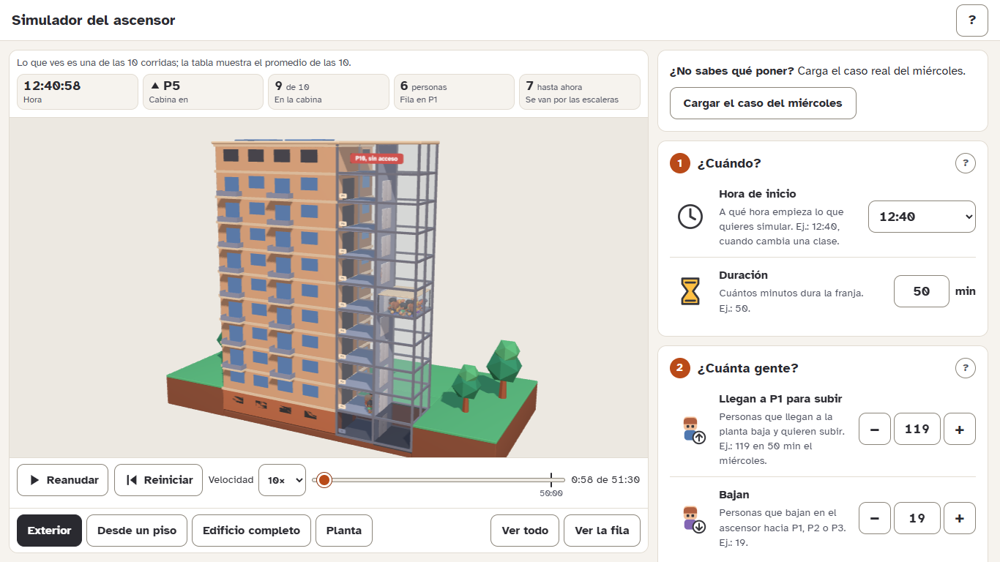
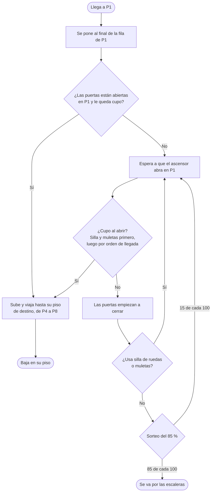
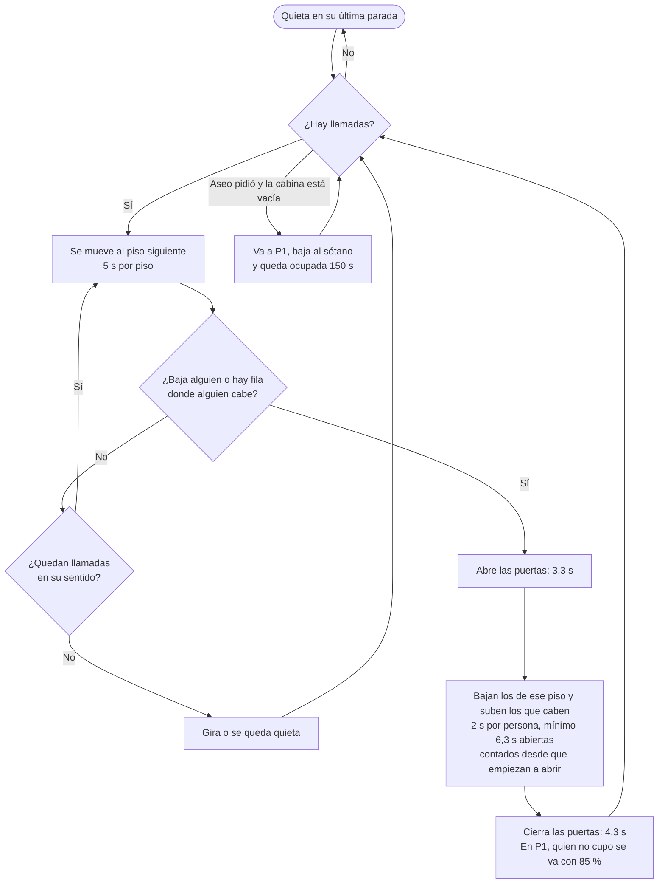
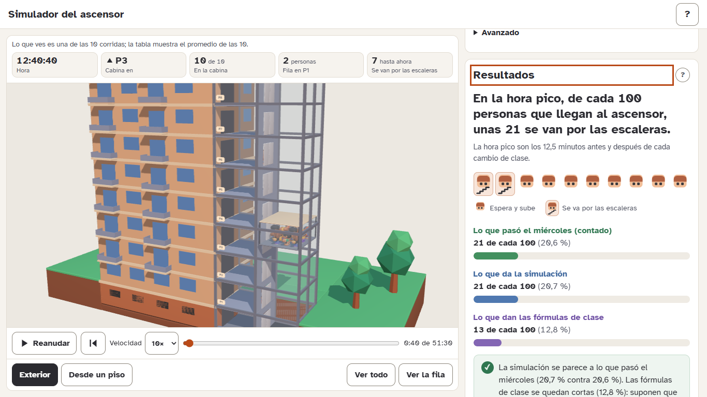
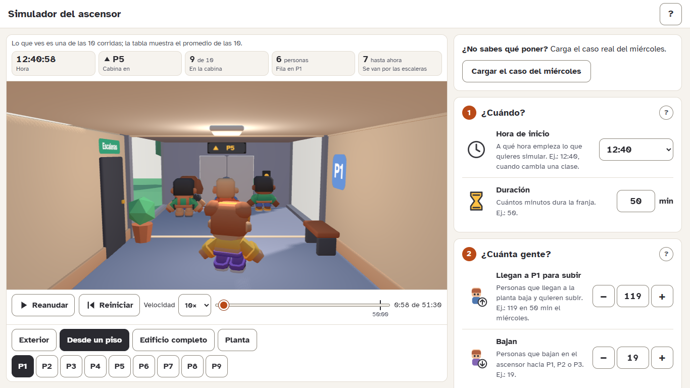
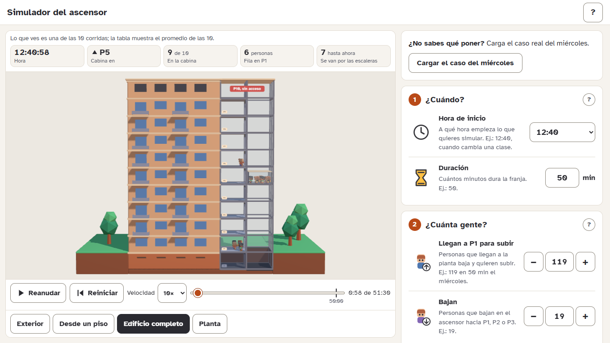
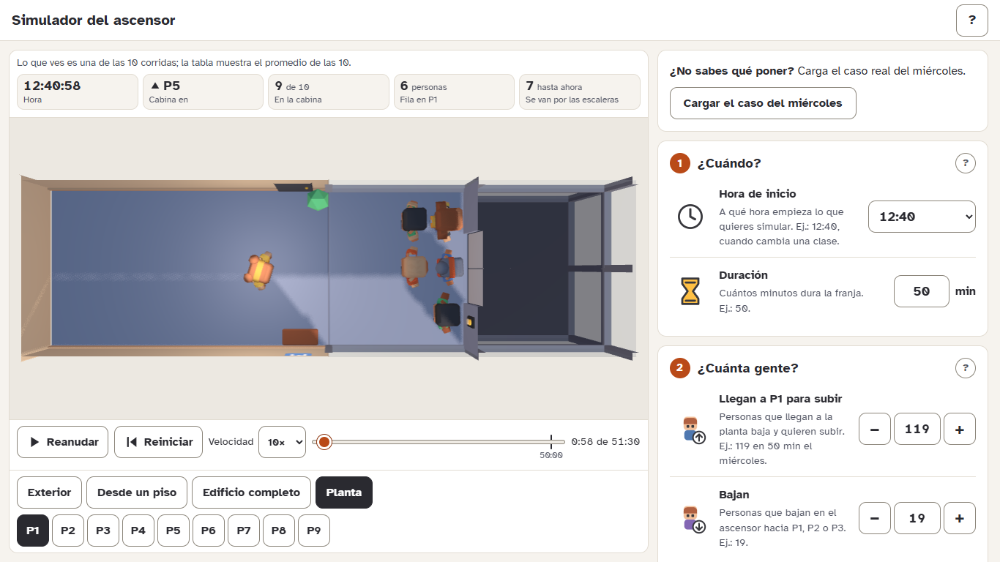
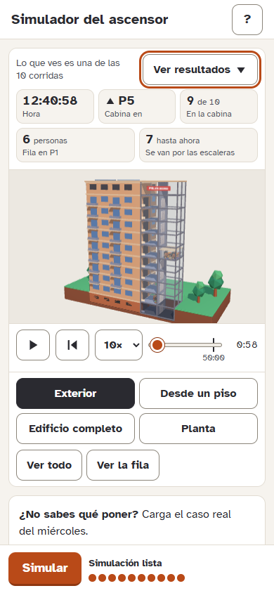

# Simulador del ascensor

**Un simulador web de un solo ascensor (cabina de 10 personas) de un edificio de la UDES. Compara el modelo de colas M/M/1/K que se ve en clase con una simulación segundo a segundo, y muestra la corrida en una escena 3D.**

<p align="center">
  <a href="https://diegitriana.github.io/simulador-ascensor/"><strong>&nbsp;&nbsp;Abrir el simulador&nbsp;&nbsp;</strong></a><br>
  <sub>https://diegitriana.github.io/simulador-ascensor/ · funciona en el navegador, sin instalar nada</sub>
</p>

<p align="center">
  <a href="https://diegitriana.github.io/simulador-ascensor/"></a>
</p>

## Contenido

1. [La pregunta y la respuesta en un vistazo](#la-pregunta-y-la-respuesta-en-un-vistazo)
2. [El sistema real](#el-sistema-real)
3. [Los datos del estudio](#los-datos-del-estudio)
4. [El modelo de clase: M/M/1/K](#el-modelo-de-clase-mm1k)
5. [La simulación segundo a segundo](#la-simulación-segundo-a-segundo)
6. [Validación: la simulación contra lo que se contó](#validación-la-simulación-contra-lo-que-se-contó)
7. [Limitaciones](#limitaciones)
8. [Cómo usar la app](#cómo-usar-la-app)
9. [Por dentro](#por-dentro)
10. [Correrlo en tu computador](#correrlo-en-tu-computador)
11. [Publicación](#publicación)
12. [Créditos y licencias](#créditos-y-licencias)
13. [Autoría y contexto académico](#autoría-y-contexto-académico)

---

## La pregunta y la respuesta en un vistazo

**Pregunta.** En la hora pico, ¿cuántas personas se van por las escaleras porque no caben en el ascensor, y por qué las fórmulas M/M/1/K de clase predicen menos de lo que pasa de verdad?

**Respuesta con el caso real del miércoles** (12:40 a 13:30, 119 personas que llegan a P1 para subir, 19 que bajan y 1 uso del aseo):

| | Fórmulas M/M/1/K | Simulación (promedio de 10 corridas ± desviación) | Real del miércoles |
|---|---|---|---|
| Se van por las escaleras **en los picos** | 12,8 % | **20,7 % ± 2,4** | **20,6 %** (22 de 107) |
| Se van por las escaleras **en toda la franja** | 0,6 % | **18,6 % ± 2,1** | **18,5 %** (22 de 119) |

*Fuente: columnas «Fórmulas» y «Simulación» de la tabla de la app con el caso del miércoles (`npm run tabla -- 10`, semillas 1 a 10); columna «Real» del documento de datos.*

> [!IMPORTANT]
> **En dos frases.** Las fórmulas se quedan cortas porque suponen que alguien se va solo cuando el sistema está lleno (10 en la cabina y 1 esperando, K = 11). En el edificio el ascensor atiende por **tandas de hasta 10** y a quien **no cabe en la cabina** se le acaba la espera y 85 de cada 100 se van por las escaleras, aunque la fila sea corta; ningún valor de K arregla eso.

Las fórmulas dan cifras distintas según la capacidad μ (personas que el ascensor sube por minuto) que se use. En todos los casos quedan por debajo de lo real:

| μ usada | Se van por las escaleras en los picos (fórmulas) | De dónde sale |
|---|---|---|
| 3,9 personas/min | 4,4 % | Cifra del documento de datos; sale con ρ ≈ 0,9. Con λ = 3,68 saldría 5,9 % |
| 3,53 personas/min | 10,4 % | μ medida en la simulación con 30 corridas (la app usa «unas 3,5» en su aviso de saturación). Calculado con `src/sim/formulas.ts` y λ = 3,68 |
| 3,38 personas/min | 12,8 % | μ medida en las 10 corridas que muestra la app |

<details>
<summary><strong>Palabras que se usan en todo el documento</strong></summary>

| Palabra | Qué significa |
|---|---|
| **Franja** | El tramo de tiempo que se simula (por ejemplo, de 12:40 a 13:30). |
| **Cambio de clase** | El momento en que termina una clase y empieza otra. El horario real de la universidad dice cuándo ocurren (ver [El sistema real](#el-sistema-real)). |
| **Pico** | Los 12,5 minutos antes y los 12,5 minutos después de cada cambio de clase, cuando llega más gente. |
| **Valle** | El resto de la franja, con pocas llegadas. |
| **Vuelta** | Un viaje del ascensor: empieza cuando abre en P1 y termina cuando vuelve a abrir en P1. |
| **Vuelta saturada** | Una vuelta en la que alguien se quedó afuera porque la cabina se llenó. |
| **Rechazo / se van por las escaleras** | Persona que no cupo en la cabina y se cansó de esperar. |
| **Corrida** | Una simulación completa de la franja. La app hace 10 y promedia. |
| **Semilla** | El número con que arranca el azar de una corrida. Mismos datos y misma semilla dan siempre el mismo resultado. |
| **λ, μ, ρ, K, L, Lq, W, Wq, P<sub>K</sub>, λef** | Los símbolos del modelo de clase; se explican en [El modelo de clase](#el-modelo-de-clase-mm1k). |

</details>

---

## El sistema real

- **Un edificio alto de la UDES, de ladrillo claro**, con **un solo ascensor** dentro de una **torre de vidrio** adosada a un costado de la fachada, como estaba cuando se hizo el estudio. Es el ascensor más antiguo del edificio y el único que llega al sótano. Hoy hay un segundo ascensor al lado, pero **no existe en este proyecto**: ni en la simulación ni en la escena.
- **Paradas:** sótano (**S**) y pisos **P1 a P9**: 10 paradas. El **P10 no tiene acceso** para el público. El sótano solo lo usa el personal de aseo con su carrito.
- **Capacidad:** 10 personas. La cabina es de cristal.
- **Clases de 50 minutos.** En la hora pico del estudio, a las 12:40 y a las 13:30 una clase termina y otra empieza al mismo tiempo.
- **Norma:** el ascensor se usa desde el piso 4. En los datos, nadie subió de P1 a P2 o P3 (0 de 149).
- **Quien no cabe en la cabina** y se cansa de esperar sale por las escaleras (la escena muestra la puerta de las escaleras en el pasillo de P1).

<details>
<summary><strong>Horario de clases de la universidad (formato de 24 horas)</strong></summary>

Cada límite entre bloques es un cambio de clase. El simulador usa esta tabla para saber qué cambios caen dentro de la franja que elijas.

| Bloque | Inicio | Fin | Duración |
|---|---|---|---|
| 1 | 06:00 | 06:50 | 50 min |
| 2 | 06:50 | 07:40 | 50 min |
| 3 | 07:40 | 08:30 | 50 min |
| 4 | 08:30 | 09:20 | 50 min |
| 5 | 09:20 | 10:10 | 50 min |
| 6 | 10:10 | 11:00 | 50 min |
| 7 | 11:00 | 11:50 | 50 min |
| 8 | 11:50 | 12:40 | 50 min |
| 9 | 12:40 | 13:30 | 50 min |
| 10 | 13:30 | 14:20 | 50 min |
| 11 | 14:20 | 15:10 | 50 min |
| 12 | 15:10 | 16:00 | 50 min |
| 13 | 16:00 | 16:50 | 50 min |
| 14 | 16:50 | 17:40 | 50 min |
| 15 | 17:40 | 18:20 | 40 min |
| 16 | 18:20 | 19:05 | 45 min |
| 17 | 19:05 | 19:50 | 45 min |
| 18 | 19:50 | 20:35 | 45 min |
| 19 | 20:35 | 21:20 | 45 min |
| 20 | 21:20 | 22:05 | 45 min |

*Fuente: horario de la universidad (`src/data/horario.ts`).*

</details>

---

## Los datos del estudio

### Cómo se recolectaron

Una persona, parada afuera del ascensor en P1, anotó cada parada durante tres franjas. Como la cabina es de cristal, desde P1 se veía cuántas personas subían y bajaban en cada piso. Además hay una tabla con los ratos en que el ascensor estuvo quieto y los usos del personal de aseo.

| Día | Franja | Para qué sirve | Llegadas a P1 para subir | Fila máxima | Se fueron por las escaleras | Usos del aseo |
|---|---|---|---|---|---|---|
| Viernes 16 de octubre | 11:00 a 12:40 | Estudio preliminar, antes de la hora pico | 29 | 6 | 0 | 2 |
| **Miércoles 21 de octubre** | **12:40 a 13:30** | **Hora pico real: la validación del simulador** | **119** (15 ya esperaban a las 12:40) | **16** | **22 (18,5 %)** | 1 |
| Lunes 26 de octubre | 12:40 a 13:30 | La misma franja con demanda baja | 23 | 7 | 0 | 1 |

*Fuente: documento «Datos del ascensor y plan de simulación» y datos recolectados en el edificio.*

Solo el miércoles hubo saturación. El lunes y el viernes nadie se fue por las escaleras.

### El miércoles, la hora pico real

- **Pico 1 (12:40 a 12:53):** 61 personas, contando las 15 que ya esperaban; 14 se fueron por las escaleras.
- **Valle (12:53 a 13:17):** 12 personas, unas 0,5 por minuto, sin rechazos.
- **Pico 2 (13:17 a 13:30):** 46 personas; 8 se fueron por las escaleras.
- **En los picos:** 22 de 107 personas se fueron: **20,6 %**. En toda la franja: 22 de 119, **18,5 %**.
- **Llegadas por minuto:** 2,1 en promedio (sin contar las 15 que ya esperaban: 104 ÷ 50 min) y 3,6 a 3,7 en los picos.
- **Quienes bajaron** tras la clase que terminó a las 12:40: 19 personas, desde P6 (9), P7 (6), P8 (2), P4 (1) y P5 (1), hacia P1 (15), P2 (2, sala de profesores) y P3 (2).

### Las aperturas del ascensor en P1 el miércoles

Cada fila es una vez que el ascensor abrió en P1. «Llegaron» son las personas que se juntaron en la fila desde la apertura anterior.

| Vuelta | Hora | Esperando | Suben | Quedan afuera | Rechazos | Llegaron |
|---|---|---|---|---|---|---|
| V1 | 12:40:30 | 15 | 10 | 5 | 4 | 15 (ya esperaban) |
| V2 | 12:42:30 | 16 | 10 | 6 | 5 | 15 |
| V3 | 12:44:35 | 14 | 10 | 4 | 3 | 13 |
| V4 | 12:48:40 | 12 | 10 | 2 | 2 | 11 |
| V5 | 12:53:10 | 7 | 7 | 0 | 0 | 7 |
| V6 | 13:01:00 | 3 | 3 | 0 | 0 | 3 |
| V7 | 13:06:15 | 1 (aseo) | 1 | 0 | 0 | — |
| V8 | 13:12:30 | 4 | 4 | 0 | 0 | 4 |
| V9 | 13:17:10 | 5 | 5 | 0 | 0 | 5 |
| V10 | 13:21:00 | 12 | 10 | 2 | 2 | 12 |
| V11 | 13:23:15 | 13 | 10 | 3 | 3 | 13 |
| V12 | 13:26:30 | 14 | 10 | 4 | 3 | 14 |
| V13 | 13:29:40 | 8 | 8 | 0 | 0 | 7 |

La duración de la vuelta (tiempo hasta la siguiente apertura en P1) solo es confiable en los picos: V1 120 s, V2 125 s, V3 245 s, V4 270 s, V10 135 s, V11 195 s y V12 190 s.

*Fuente: tabla de aperturas en P1 del documento de datos.*

### Parámetros que salen de los datos

| Parámetro | Valor | De dónde sale |
|---|---|---|
| Capacidad | 10 personas | El ascensor |
| Paradas | 10 (S y P1 a P9) | El edificio |
| Llegadas en pico (λ) | 3,6 a 3,7 personas/min | Miércoles: 46 personas en unos 12,5 min en cada pico |
| Llegadas en valle | 0,3 a 0,5 personas/min | Valle del miércoles, lunes y viernes |
| Llegadas que caen en los picos | 88 % | 92 de 104 el miércoles, sin contar las 15 que ya esperaban |
| Destinos de quienes suben desde P1 | P4 15 %, P5 25 %, P6 36 %, P7 18 %, P8 6 % | 149 personas en los tres días |
| Quienes bajan tras un cambio de clase | A P1 80 %, a P2 10 %, a P3 10 % | 19 personas el miércoles |
| Probabilidad de irse por las escaleras si no cabe | 85 % | 22 de 26 personas que no cupieron |
| K (máximo de personas en el sistema) | 11 | Tras cada vuelta llena, como mucho 1 persona se quedó esperando: 10 en la cabina + 1 |
| Duración de la vuelta en pico | 153 s (entre 120 y 195 s) | V1, V2, V10, V11 y V12 |
| Capacidad de servicio (μ) | 3,9 personas/min | 10 personas por vuelta en 153 s |
| Aseo | 150 s de uso exclusivo, de P1 al sótano con la cabina vacía | Tabla de eventos (los 4 usos duraron exactamente 2:30) |
| Ascensor sin llamadas | Se queda en su última parada | Observación |
| Silla de ruedas y muletas | 3 y 2 cupos; no se van por las escaleras y suben primero | Reglas del plan de simulación |

*Fuente: tabla «Parámetros que salen de los datos» del documento de datos.*

### Tiempos del ascensor

Ajustados al miércoles para que la simulación reproduzca la vuelta medida:

| Tiempo | Valor |
|---|---|
| Subir o bajar un piso | 5 s |
| Abrir las puertas | 3,3 s |
| Cerrar las puertas | 4,3 s |
| Mínimo con las puertas abiertas | 6,3 s |
| Entrar o salir una persona | 2 s por persona |
| Aseo | 150 s |

Los tiempos que se anotaron en los pisos altos **no se usan como dato**: son aproximados (78 de 79 horas terminan en 0 o en 5 segundos).

---

## El modelo de clase: M/M/1/K

**M/M/1/K** es el modelo de colas que se ve en clase. Dice que las personas llegan al azar (una por una, a un ritmo promedio), que hay **un solo servidor** (aquí, el ascensor) que atiende al azar a un ritmo promedio, y que en el sistema caben como máximo **K personas**: si llega alguien y ya hay K, esa persona se va. Aquí **K = 11**: 10 en la cabina y 1 esperando.

### Símbolos

| Símbolo | Qué es |
|---|---|
| λ | Personas que llegan por minuto. En la tabla: personas ÷ duración de la franja, o las que llegan dentro de los picos. |
| μ | Personas que el ascensor sube por minuto cuando hay fila. La app usa la que **mide la simulación**. |
| ρ | λ ÷ μ. Si pasa de 1, llega más gente de la que el ascensor puede subir. |
| K | Máximo de personas en el sistema: 11. |
| L | Personas en el sistema (fila y cabina), en promedio. |
| L<sub>q</sub> | Personas en la fila, en promedio. |
| W | Tiempo desde que llegan hasta que bajan. |
| W<sub>q</sub> | Tiempo de espera en la fila. |
| P<sub>K</sub> | Probabilidad de que el sistema esté lleno: alguien llega y se va. En las fórmulas es el % que se va por las escaleras. |
| λef | Personas que sí entran al ascensor por minuto: λ(1 − P<sub>K</sub>). |

### Fórmulas

Son las de la profesora, sin cambiarlas:

$$\rho = \frac{\lambda}{\mu} \qquad P_0 = \frac{1-\rho}{1-\rho^{K+1}} \qquad P_n = P_0\,\rho^{n}$$

$$L = \frac{\rho}{1-\rho} - \frac{(K+1)\,\rho^{K+1}}{1-\rho^{K+1}} \qquad L_q = L - (1-P_0)$$

$$W = \frac{L}{\lambda} \qquad W_q = \frac{L_q}{\lambda}$$

Se agregan tres cosas, sin cambiar las fórmulas:

$$P_K = P_n \text{ con } n = K \qquad \lambda_{ef} = \lambda\,(1-P_K) \qquad W = \frac{L}{\lambda_{ef}}$$

- **P<sub>K</sub>** es la probabilidad de que alguien llegue y se vaya.
- **λef** son las personas que sí usan el ascensor. **W = L/λef** es el tiempo de quien entra, que es el comparable con la simulación (con W = L/λ el tiempo sale como promedio de todas las que llegan, y 0 para quien se va). La tabla de la app usa W = L/λef.
- **Caso ρ = 1:** la fórmula divide por cero. Se usa $P_0 = \frac{1}{K+1}$ y $L = \frac{K}{2}$.

**Ejemplo con los picos del miércoles:** con λ = 3,68 y μ = 3,38 sale ρ ≈ 1,09 y P<sub>0</sub> ≈ 0,050, así que P<sub>K</sub> = P<sub>0</sub> · ρ<sup>11</sup> ≈ 0,128: **12,8 %** de las personas se irían.

### Valores para el caso del miércoles

La tabla de la app compara, con **λ de toda la franja** (119 ÷ 50 min, como pide el documento) y con **λ de los picos** (medida en la simulación igual que en los datos), las fórmulas con la simulación. μ es la medida en la simulación en ambos casos.

| | Fórmulas, λ de toda la franja | Fórmulas, λ de los picos | Simulación, toda la franja (entre paréntesis, los picos) |
|---|---|---|---|
| Se van por las escaleras (P<sub>K</sub>) | 0,6 % | 12,8 % | 18,6 % ± 2,1 (20,7 % ± 2,4) |
| λ (personas/min) | 2,38 | 3,68 | 2,38 (3,68) |
| μ (personas/min) | 3,38 | 3,38 | 3,38 ± 0,47 |
| ρ | 0,71 | 1,09 | 0,72 ± 0,12 (1,11 ± 0,19) |
| L (personas) | 2,2 | 6,5 | 4,4 ± 0,2 (8,1 ± 0,5) |
| L<sub>q</sub> (personas) | 1,5 | 5,6 | 2,4 ± 0,2 (4,4 ± 0,5) |
| W (s) | 56 | 122 | 128 ± 6 |
| W<sub>q</sub> (s) | 38 | 104 | 64 ± 6 |
| λef (personas/min) | 2,36 | 3,21 | 1,94 ± 0,05 |
| **Real** | | | **20,6 % en picos, 18,5 % en toda la franja** |

*Fuente: tabla comparativa de la app con el caso del miércoles, 10 corridas con semillas 1 a 10. «±» es la desviación estándar entre corridas. La λ de la franja de la simulación es un dato de entrada (sin ±).*

> [!NOTE]
> Con λ de toda la franja (2,38 personas/min) las fórmulas dan 0,6 % y no hay nada que contrastar con lo real. El 20,6 % que se contó es de los picos, así que **la comparación justa es la de la primera fila con λ de los picos**.

> [!NOTE]
> **¿Por qué la μ medida (3,38) es menor que la del documento (3,9)?** μ son las personas que suben por minuto en las vueltas saturadas. En la simulación esas vueltas duran unos 165 s en promedio (de 121 a 222 s), y las medidas en el edificio, 153 s. Con 10 personas por vuelta, 153 s dan 3,9 por minuto y 165 s dan unos 3,6. Además algunas vueltas suben menos de 10 porque entra una silla de ruedas o porque el cupo se ocupa con quienes bajan. Con solo 10 corridas μ puede salir entre 3,3 y 3,6; en promedio de muchas corridas sale cerca de 3,5.

---

## La simulación segundo a segundo

### Idea general

El programa recrea el edificio durante la franja que elijas, **un segundo a la vez**: va poniendo gente en las filas, mueve el ascensor, abre y cierra puertas, sube y baja personas y anota qué pasa. No usa fórmulas de colas: cuenta lo que ocurre. Como las llegadas dependen del azar, **se corre 10 veces** y se promedia.

### Qué entra y qué es fijo

Siete entradas, que escribe quien usa el programa: **hora de inicio, duración, personas que llegan a P1 para subir, personas que bajan, sillas de ruedas, muletas y usos del aseo.** Todo lo demás es fijo y sale de los datos: capacidad 10, K = 11, paradas, destinos, el 85 %, los tiempos del ascensor y los 150 s del aseo.

### Cómo se reparten las llegadas en el tiempo

1. **Se buscan los cambios de clase** del horario real que caen dentro de la franja.
2. **Picos:** 12,5 min antes y 12,5 min después de cada cambio de clase, recortados a la franja. **Valle:** el resto.
3. **88 %** de las llegadas va a los picos y el **12 %** restante al valle, repartido parejo. Si la franja no tiene ningún cambio de clase no hay picos: todas las llegadas se reparten parejo.
4. **Dentro de cada pico las llegadas no son parejas.** La forma sale de la columna «Llegaron» del miércoles, tramo por tramo entre aperturas en P1:
   - Pico **después** de un cambio de clase: 15 personas en 120 s, 13 en 125 s, 11 en 245 s y 7 en 270 s.
   - Pico **antes** de un cambio de clase: 12 personas en 230 s, 13 en 135 s, 14 en 195 s y 7 en 190 s.
   
   La forma se escala al total de cada pico, y el instante de cada llegada se sortea dentro de su tramo.
5. **Quienes ya esperaban al empezar.** Si la franja empieza justo en un cambio de clase, una parte de las llegadas ya está en la fila a esa hora: en el miércoles eran 15 de 119, y esa proporción se escala con las llegadas.
6. **Destino de quien sube desde P1:** P4 15 %, P5 25 %, P6 36 %, P7 18 % y P8 6 %.
7. **Sillas de ruedas y muletas** se cuentan dentro de las personas que llegan a P1 y ocupan al azar algunas de esas llegadas.
8. **Quienes bajan:** se reparten en los 12,5 min posteriores a cada cambio de clase de la franja (sin contar uno que caiga justo al final). Salen de P4 (1 de 19), P5 (1), P6 (9), P7 (6) o P8 (2) y van a P1 (80 %), P2 (10 %) o P3 (10 %).
9. **Aseo:** las solicitudes se reparten parejo en la franja. El personal solo usa el ascensor cuando la cabina está vacía y no hay llamadas: va a P1, sube con su carrito, baja al sótano y la cabina queda ocupada 150 s.

### Las reglas de cada segundo

1. **Llegan y se forman.** Las personas que llegan en ese segundo se ponen al final de la fila de su piso.
2. **Con las puertas abiertas** bajan quienes llegaron a su piso y suben, por orden de llegada, quienes caben. Silla de ruedas y muletas **suben primero**. Una silla ocupa **3 cupos** y unas muletas **2**.
3. **Al cerrar en P1,** cada persona que no cupo se va por las escaleras con **85 %** de probabilidad. Quien usa silla de ruedas o muletas no se va por las escaleras.
4. **Sin estar parado,** el ascensor sigue en su sentido mientras haya llamadas, gira cuando no quedan y, sin ninguna, se queda quieto en su última parada.
5. **Aseo:** con la cabina vacía va a P1, baja al sótano y queda ocupado 150 s.
6. **Se anotan** la fila, la ocupación, los rechazos y las esperas.

Por dentro el tiempo se cuenta en décimas de segundo para que los 3,3 s y los 4,3 s de las puertas sean exactos.

### El recorrido de una persona que sube desde P1



Cada vez que las puertas cierran en P1, quien no cupo vuelve a sortear su 85 %.

### El ciclo de la cabina



### Por qué 10 corridas y qué es el ±

Con una sola corrida el resultado cambia mucho por azar: en las 10 corridas del miércoles el % que se va por las escaleras en los picos va de 15,0 % a 23,4 %. Por eso la tabla muestra el **promedio de 10 corridas** y, con **±**, la **desviación estándar**: cuánto cambia cada cifra de una corrida a otra.

### La semilla y la animación

- **Semilla.** El azar de cada corrida sale de un generador con semilla (mulberry32). Las 10 corridas usan las semillas 1 a 10 (semilla base 1, más el número de corrida). Con los mismos datos y la misma semilla el resultado es **siempre el mismo**. En «Avanzado», el botón «Otra muestra aleatoria» cambia la semilla.
- **La animación es la corrida 1**, la de la semilla 1, exactamente la primera de las 10 que se promedian. Por eso lo que se ve **no coincide cifra por cifra con la tabla**: en el miércoles, la corrida 1 termina con 23 personas que se van por las escaleras (21,5 % en los picos), y la tabla muestra el promedio de las 10 (20,7 %). La escena lo dice con una línea: «Lo que ves es una de las 10 corridas; la tabla muestra el promedio de las 10».

---

## Validación: la simulación contra lo que se contó

**Validación obligatoria del proyecto:** con el caso del miércoles, el promedio de 10 corridas debe dar un abandono cercano al 20 % real.

| Medida | Simulación (10 corridas, semillas 1 a 10) | Real del miércoles |
|---|---|---|
| Se van por las escaleras en los picos | **20,7 % ± 2,4** (entre corridas: de 15,0 % a 23,4 %) | **20,6 %** |
| Se van por las escaleras en toda la franja | **18,6 % ± 2,1** | **18,5 %** |
| λ en los picos | 3,68 personas/min | 3,6 a 3,7 |
| Duración de la vuelta saturada | 165 s en promedio (de 121 a 222 s) | 153 s (de 120 a 195 s) |
| μ | 3,38 ± 0,47 personas/min | 3,9 (del documento) |
| Fila máxima | 19,8 ± 2,4 personas | 16 |
| Fila promedio en los picos (L<sub>q</sub>) | 4,4 ± 0,5 | No se midió; el primer prototipo daba 6,0 |

*Fuente: `npm run tabla -- 10` y columna «Real» del documento de datos.*

El primer prototipo (30 corridas) daba 22,0 % ± 1,7 en los picos. Para esta versión se ajustaron dos cosas, y solo esas dos.

### La brecha y cómo se cerró

Con las reglas del documento tal cual, el abandono en los picos daba cerca de **15 %** (promedio de 10 corridas) y la vuelta saturada duraba unos **181 s**. Se hicieron dos cambios:

- **B. Los 6,3 s mínimos con las puertas abiertas se cuentan desde que empiezan a abrir** (los 3,3 s de abrir más el resto), no desde que están abiertas. Razón: calibrar la vuelta contra la medida (153 s, entre 120 y 195 s), como se calibró el prototipo. El texto del documento admite las dos lecturas.
- **C. La forma de las llegadas dentro de cada pico.** Antes eran parejas (3,7 por minuto); los datos muestran que no lo son (39 personas en los primeros 8 minutos del pico 1, o sea 4,8 por minuto). La forma sale de la columna «Llegaron» del miércoles (ver [La simulación segundo a segundo](#la-simulación-segundo-a-segundo)). El 88 % en picos y el resto en el valle no cambian.

### Qué se tomó como supuesto

- Las sillas de ruedas y muletas se cuentan **dentro** de las personas que llegan a P1, no aparte.
- Quienes ya esperaban al inicio (15 de 119) solo existen si la franja empieza en un cambio de clase, y se escalan con las llegadas.
- Los picos miden 12,5 minutos a cada lado de cada cambio de clase, recortados a la franja.
- Quienes bajan se reparten en los 12,5 minutos posteriores a cada cambio de clase de la franja.
- El aseo pide el ascensor repartido parejo en la franja y lo usa con la cabina vacía y sin llamadas; 150 s desde que abre en P1.
- Después de terminar la franja la simulación sigue (hasta 1 hora) hasta atender a todos, pero las medidas de fila solo cuentan dentro de la franja.
- **A. Grupos que suben al mismo piso (apagado).** En el edificio, quienes suben juntos suelen ir al mismo piso (1,6 pisos distintos por vuelta en los datos) y llegan juntos (el lunes, 7 personas a la vez). El documento ya lo menciona como limitación y **la simulación no lo activa**: cada persona llega y elige destino por separado. La opción existe en el código, apagada, y no se usa en los resultados.

<details>
<summary><strong>¿Qué pasaría con grupos? (exploración, no es un dato medido)</strong></summary>

Para ver cuánto pesa esa limitación se corrió la simulación con grupos de varios tamaños (10 corridas, semillas 1 a 10, caso del miércoles). Esto **no está en la app**:

| Tamaño medio del grupo | Se van por las escaleras en picos | μ (personas/min) | Fila promedio en picos | Vuelta saturada |
|---|---|---|---|---|
| 1 (lo que usa la app) | 20,7 % ± 2,4 | 3,38 ± 0,47 | 4,4 ± 0,5 | 165 s |
| 3 | 18,2 % ± 2,2 | 3,97 ± 0,37 | 3,6 ± 0,5 | 152 s |
| 5 | 20,9 % ± 2,2 | 4,10 ± 0,38 | 3,5 ± 0,5 | 145 s |
| 7 | 25,3 % ± 2,3 | 3,88 ± 0,69 | 3,4 ± 0,8 | 160 s |

Con grupos de 3 a 5, la vuelta y μ se acercan a las medidas (153 s y 3,9 por minuto). Es probable que los grupos expliquen por qué la vuelta simulada es más larga que la real.

*Fuente: `npm run tabla -- 10`, sección «Sensibilidad a grupos».*

</details>

---

## Limitaciones

> [!WARNING]
> **La validación es de un solo día de pico (el miércoles).** Es una guía, no una prueba definitiva.

- **Solo se simulan tres flujos:** las personas que llegan a P1 para subir, las que bajan después de un cambio de clase y los usos del aseo, porque son los que se contaron en el estudio. Los **viajes entre pisos altos** y las personas que **se cansan de esperar y se van por las escaleras desde un piso alto** no se observaron, así que no se incluyen ni se inventan.
- **Las personas llegan de una en una.** En el edificio suelen llegar en grupos que van al mismo piso; eso probablemente alarga la vuelta simulada (unos 165 s contra 153 s medidos).
- **La forma de las vueltas no coincide una a una con la real.** La simulación satura más V1 y V2 (en promedio 6,9 y 9,2 rechazos contra 4 y 5 reales) y deja V4 casi vacía (0 contra 2). El total coincide, la secuencia no. La fila máxima simulada también es mayor (19,8 contra 16).
- **μ medida y μ del documento.** La tabla usa la μ que mide la simulación, no los 3,9 del documento (ver [El modelo de clase](#el-modelo-de-clase-mm1k)).
- **Los tiempos de los pisos altos no se usan como dato:** las horas anotadas se redondearon a 5 s. Las demoras sin paradas anotadas (de P6 a P8 hasta P1, de 105 a 155 s) se tratan como demoras no observadas.
- **Viajes cortos a P1 → P2 o P3:** no aparecen en los datos (0 de 149), así que no se simulan.
- **Un solo ascensor.** No existe un segundo, ni en la simulación ni en la escena.
- **La cabina de la escena se dibuja más grande que la real** para que quepan 10 personas sin solaparse; la capacidad sigue siendo 10.
- **La escena necesita WebGL.** Sin WebGL, el formulario y los resultados funcionan igual.
- **Rangos de las entradas:** los límites del formulario (por ejemplo, hasta 960 min o 3000 personas) son una propuesta del proyecto, aprobada para esta app; no vienen de los documentos de datos.

---

## Cómo usar la app

Abre **https://diegitriana.github.io/simulador-ascensor/**. En escritorio, la escena queda a la izquierda y los datos y resultados a la derecha; en celular, la escena va arriba y el botón **Simular** queda fijo abajo.

> [!TIP]
> Si no sabes qué escribir, pulsa **Cargar el caso del miércoles**: llena 12:40, 50 minutos, 119 personas que llegan, 19 que bajan, 0 sillas, 0 muletas y 1 uso del aseo.

### Los 4 pasos

1. **¿Cuándo?** La *hora de inicio* se elige de una lista con los cambios de clase del horario (o «Otra hora», en formato de 24 horas) y la *duración* se escribe en minutos.
2. **¿Cuánta gente?** Las personas que **llegan a P1 para subir** (incluyen a quienes van en silla de ruedas o con muletas) y las que **bajan** después de un cambio de clase.
3. **Casos especiales.** Personas en **silla de ruedas**, con **muletas** y veces que el **aseo** usa el ascensor.
4. **Simular.** Se simula 10 veces la misma franja y se promedia. Mientras corre se ve «Corrida N de 10» con 10 círculos, y se puede cancelar.

| Dato | Rango que acepta |
|---|---|
| Hora de inicio | De 06:00 a 22:04 |
| Duración | De 1 a 960 min; inicio + duración no puede pasar de las 22:05 |
| Llegan a P1 para subir | De 0 a 3000 |
| Bajan | De 0 a 1000 |
| Sillas de ruedas | De 0 a 20, y no más que las que llegan |
| Muletas | De 0 a 50, y no más que las que llegan menos las sillas |
| Usos del aseo | De 0 a 50 |

Todos los datos son números enteros. Se puede escribir con coma o con punto, pero si trae decimales (por ejemplo `5,0`) se rechaza con un mensaje claro; igual con los campos vacíos, las letras o los negativos. Si la tasa esperada en los picos pasa de 3,5 personas por minuto, la app avisa que el ascensor probablemente se saturará; el aviso no bloquea.

### Cómo leer los resultados

<p align="center">
  
</p>

- **La frase principal** cuenta cuántas de cada 100 personas se van por las escaleras, con una explicación de qué es «la hora pico».
- **10 cabecitas:** las marcadas con una escalera son las que se van.
- **Tres barras con los mismos colores siempre:** verde, *lo que pasó el miércoles* (solo con el caso del miércoles); azul, *lo que da la simulación*; morado, *lo que dan las fórmulas de clase*.
- **Una conclusión** que se escribe sola, solo con lo que es verdad para esas cifras (por ejemplo, «las fórmulas de clase se quedan cortas»).
- **Tres frases:** hasta cuánto llegó la fila, cuánto se esperó en promedio y cuánto tarda el ascensor en subir y volver.
- **«Detalle para la clase»:** una línea por símbolo (λ, μ, ρ, L, L<sub>q</sub>, W, W<sub>q</sub>, P<sub>K</sub>, λef y ±) y la tabla comparativa de [El modelo de clase](#el-modelo-de-clase-mm1k).
- Si cambias los datos después de simular, un aviso dice que **los resultados ya no corresponden** a lo que está escrito.

### La escena y el reproductor

Al terminar de simular, la escena muestra **la corrida 1**. Sobre la escena hay cinco indicadores en vivo: la **hora**, el **piso de la cabina** (con flecha), **cuántas personas van en la cabina** (de 10), la **fila en P1** y **cuántas se han ido por las escaleras** hasta ahora.

Debajo está el reproductor:

| Control | Qué hace |
|---|---|
| **Pausar / Reanudar / Ver de nuevo** | Pausa congela todo al instante. Al terminar la corrida el botón dice «Ver de nuevo». |
| **Reiniciar** | Vuelve al segundo 0 de la misma corrida y la deja en pausa. No simula de nuevo ni toca los resultados. |
| **Velocidad** | 1×, 2×, 5×, 10×, 30× o 60×. Empieza en 10×. |
| **Barra de tiempo** | Lleva a cualquier momento de la corrida. Una marca señala dónde termina la franja (50:00 en el miércoles); después de esa marca la escena dice «Terminó la franja; el ascensor atiende a quien quedó en la fila.» |

> [!NOTE]
> Antes de simular, la escena muestra una **escena de muestra** con la etiqueta «Escena de muestra. Pulsa Simular para ver una corrida.» Simular de nuevo, cancelar, cambiar un dato o cargar otro caso descarta la corrida que se veía.

### Las cuatro vistas

| Vista | Qué muestra |
|---|---|
| **Exterior** | El edificio de ladrillo con su torre de vidrio. Se ve subir y bajar la cabina con gente y la fila de P1 al pie de la torre. La cámara se puede girar y acercar. «Ver todo» la devuelve al encuadre completo y «Ver la fila» la acerca a P1. |
| **Desde un piso** | La cámara en el pasillo, frente a la puerta del ascensor de un piso, como la vería alguien que espera. Un selector (P1 a P9) cambia de piso. |
| **Edificio completo** | El corte del edificio de frente, del sótano al P10 (rotulado «P10, sin acceso»), para ver dónde está la cabina y las filas de cada piso. |
| **Planta** | La vista desde arriba del pasillo, el vestíbulo y el pozo del piso elegido (P1 a P9). |

<table>
  <tr>
    <td width="50%"></td>
    <td width="50%"></td>
  </tr>
  <tr>
    <td align="center"><sub><strong>Desde un piso</strong> (P1)</sub></td>
    <td align="center"><sub><strong>Edificio completo</strong></sub></td>
  </tr>
  <tr>
    <td width="50%"></td>
    <td width="50%"></td>
  </tr>
  <tr>
    <td align="center"><sub><strong>Planta</strong> (P1)</sub></td>
    <td align="center"><sub><strong>En el celular</strong>: escena arriba, Simular fijo abajo</sub></td>
  </tr>
</table>

Cambiar de vista **no pausa ni reinicia nada**. En celular, «Ver resultados» baja a los resultados y las cuatro vistas van en dos filas.

---

## Por dentro

<details>
<summary><strong>Tecnologías y versiones</strong></summary>

| Para qué | Qué | Versión |
|---|---|---|
| Herramienta de construcción | [Vite](https://vite.dev) | 8.3.5 |
| Interfaz | [React](https://react.dev) | 19.3.1 |
| Lenguaje | [TypeScript](https://www.typescriptlang.org) | 7.0.2 |
| Escena 3D | [three.js](https://threejs.org) | 0.187.0 |
| Escena 3D en React | [React Three Fiber](https://r3f.docs.pmnd.rs) | 9.8.2 |
| Ayudas para la escena (control de cámara, cajas redondeadas) | [Drei](https://drei.docs.pmnd.rs) | 10.7.9 |
| Estado | [Zustand](https://zustand.docs.pmnd.rs) | 5.0.16 |
| Pruebas | [Vitest](https://vitest.dev) | 5.0.5 |
| Compresión de modelos (solo desarrollo) | [meshoptimizer](https://github.com/zeux/meshoptimizer) | 1.1.1 |

La simulación corre en un **Web Worker**. Las versiones están fijadas en `package.json`.

*Fuente: [package.json](package.json).*

</details>

<details>
<summary><strong>Estructura de carpetas</strong></summary>

```
simulador-ascensor/
├─ src/
│  ├─ sim/      TypeScript puro y con pruebas: fórmulas M/M/1/K, reparto de llegadas,
│  │            simulación por segundo, corridas, generador con semilla y validación de entradas
│  ├─ worker/   El Web Worker (las 10 corridas con progreso y cancelación) y su cliente
│  ├─ store/    Estado con Zustand: la app, el reloj de la animación, la vista de la escena y la calidad
│  ├─ ui/       Formulario, resultados, tabla comparativa, reproductor y Ayuda
│  ├─ scene/    Escena 3D: edificio, torre, pasillo, personas, cámara, vistas y calidad adaptable
│  └─ data/     Parámetros fijos, horario, forma de los picos, caso del miércoles, rangos y modelos
├─ public/
│  ├─ modelos/  9 modelos .glb comprimidos y la textura compartida colormap.png
│  └─ fuentes/  Atkinson Hyperlegible (woff2) y sus licencias
├─ scripts/     tabla-miercoles.ts, medir-traza.ts y preparar-modelos.ts
├─ recursos/
│  └─ readme/   Las capturas de este README (no van a la página publicada)
└─ .github/
   └─ workflows/desplegar.yml   El despliegue a GitHub Pages
```

</details>

<details>
<summary><strong>El worker</strong></summary>

La página y el worker se hablan con mensajes. La página manda `simular` (con los datos, la semilla y el número de corridas) o `cancelar`. El worker responde `progreso` (cuántas corridas lleva), `traza` (la de la corrida 1, para animar), `resultado`, `cancelado` o `error`.

- **El worker no bloquea la página:** cede el hilo entre una corrida y otra, así que se puede cancelar entre corridas y la interfaz sigue respondiendo.
- **Número de generación.** Cada petición lleva un número de generación; la página sube ese número al simular, cancelar o cambiar los datos, y **descarta cualquier mensaje de otra generación**. Así un resultado viejo nunca pisa a uno nuevo.
- **Un solo dueño del estado.** La corrida que se anima y las 10 del worker no comparten estado.
- **Los errores llegan como mensaje**, sin pantalla en blanco. El worker valida los datos otra vez por su cuenta.

</details>

<details>
<summary><strong>La traza de la corrida animada</strong></summary>

Para animar, la simulación puede llenar una **traza**: la lista de hechos de la corrida con su segundo (la cabina se mueve, las puertas abren, quedan abiertas o cierran, una persona sube, baja o se va por las escaleras, el aseo termina) y la lista de personas. La traza solo anota: **no usa el generador aleatorio ni cambia nada de lo que se calcula**, así que el resultado es idéntico con y sin traza (hay pruebas con varias semillas y con el caso del miércoles).

La escena arma la traza en un índice una sola vez y, para cualquier segundo, calcula dónde está la cabina, cuánto abiertas están las puertas y dónde está cada persona. **No guarda nada entre cuadros**, así que pausar congela todo y cualquier salto del reloj (la barra, volver al inicio o volver a la pestaña) coloca todo de una vez. Un solo cuadro nunca avanza más de 0,25 s reales, para que una pestaña oculta no dé un salto.

</details>

<details>
<summary><strong>Robustez: qué pasa cuando algo falla</strong></summary>

- **La animación depende del reloj simulado, nunca del reloj real.** Pausar congela todo.
- **Recolocar en vez de animar** cuando el reloj salta.
- **Lo visual sigue a lo visible:** la puerta se abre cuando la cabina llega y la persona sale de la fila cuando entra de verdad.
- **El costo de cada cuadro no depende del tamaño de las filas.** Se dibujan como máximo 12 personas por piso y el resto va en un cartel «+N personas» colgado en el vestíbulo.
- **Sin WebGL:** un aviso («No se pudo mostrar la escena 3D») y el formulario y los resultados siguen funcionando. Si se pierde el contexto WebGL, pasa lo mismo.
- **Si un modelo no carga**, se dibuja una figura simple en su lugar. La escena tiene límites de error, así que un fallo ahí no tumba la página.
- **Calidad adaptable.** Si los cuadros por segundo bajan de 30 en dos ventanas seguidas de 2 s, la escena baja un nivel: 0 completo (sombras, hasta 2× de resolución), 1 sin sombras, 2 hasta 1× de resolución y 3 hasta 0,75×. Solo baja y avisa («Calidad reducida para que la escena vaya fluida»).
- **Movimiento reducido** (`prefers-reduced-motion`): el cambio de vista es inmediato, no hay rebotes y la corrida empieza en pausa.
- **Reproducible:** misma semilla y mismos datos dan el mismo resultado.
- **Validación de entradas:** nunca llega un valor inválido a la simulación.
- **Sin peticiones externas:** las fuentes y los modelos se sirven desde la propia página.

</details>

<details>
<summary><strong>Accesibilidad</strong></summary>

- Foco visible (anillo de 3 px) y manejo completo con el teclado.
- El estado de Simular se anuncia con `aria-live`; al terminar, el foco va al título de los resultados, y al pulsar Simular con errores, al primer campo con error.
- Ningún mensaje depende solo del color; el pictograma tiene texto alternativo y los íconos decorativos se ocultan a los lectores de pantalla.
- Contraste de color comprobado con pruebas (WCAG AA).
- Botones de al menos 44 px en celular.
- Letra [Atkinson Hyperlegible](https://brailleinstitute.org/freefont), pensada para leerse bien.
- Español sencillo en los textos.
- Con `prefers-reduced-motion` se apagan los movimientos.

</details>

<details>
<summary><strong>Rendimiento medido</strong></summary>

**Costo de la simulación** (en Node, `npm run traza`):

| Caso | Corrida | Eventos de la traza |
|---|---|---|
| Miércoles (139 personas) | 1,5 ms, igual con traza | 805 (47 KB en JSON) |
| Peor caso: 06:00, 960 min, 3000 llegan, 1000 bajan, 20 sillas, 50 muletas y 50 usos del aseo (4001 personas) | unos 20 ms con traza | 18 637 (1186 KB en JSON; copiarla entre hilos: unos 15 ms) |

**Costo por cuadro de la escena:** de 4 a 8 µs con filas de hasta 658 personas (medido en Node); armar el índice de la traza en el peor caso toma unos 20 ms.

**Tamaño de lo que se descarga** (`npm run build`):

| Archivo | Tamaño | Comprimido (gzip) |
|---|---|---|
| Página (React, formulario, resultados) | 294,56 kB | 93,22 kB |
| Escena 3D (se carga aparte) | 1.038,85 kB | 278,52 kB |
| Worker | 13,04 kB | |
| Estilos | 21,70 kB | 5,24 kB |
| Modelos 3D (9 .glb y textura) | 682,5 KB | |

La escena se carga **después** del formulario (`React.lazy`), así que el formulario no espera a three.js.

**Cuadros por segundo en el navegador:** [PENDIENTE: valor medido en el navegador real, que no quedó anotado en el plan]. La prueba en un celular real (simular, las cuatro vistas, «Ver resultados», girar la pantalla) salió bien y la escena iba fluida.

</details>

<details>
<summary><strong>Pruebas</strong></summary>

`npm test` corre **331 pruebas en 27 archivos**: las fórmulas M/M/1/K (casos hechos a mano, incluido ρ = 1), la simulación, las llegadas, el caso sin cambio de clase, la validación de entradas, el worker, la traza (resultado idéntico con y sin ella, la corrida animada es la corrida 1 de la tabla), el estado de la escena, las vistas y los textos de los resultados.

</details>

---

## Correrlo en tu computador

**Requisitos:** [Node.js](https://nodejs.org) 22.18 o más nuevo (Vite 8 pide 22.12; los scripts de `scripts/` corren TypeScript directo) y npm.

```bash
git clone https://github.com/DiegiTriana/simulador-ascensor.git
cd simulador-ascensor
npm install
```

| Comando | Para qué |
|---|---|
| `npm run dev` | Servidor de desarrollo en http://localhost:5173/ |
| `npm test` | Pruebas (Vitest) |
| `npm run typecheck` | Revisa los tipos (TypeScript) |
| `npm run build` | Revisa los tipos y genera la carpeta `dist/` |
| `npm run preview` | Sirve `dist/` tal como quedará publicado, en http://localhost:4173/simulador-ascensor/ (con la barra final) |
| `npm run tabla` | Imprime en la consola la tabla del caso del miércoles; con `npm run tabla -- 10` usa 10 corridas, como la app |
| `npm run traza` | Mide el costo de la traza en el caso del miércoles y en el peor caso |

### Probarlo en el celular por wifi

Con el computador y el celular en la **misma red wifi**:

```bash
npm run dev:celular
```

Vite imprime una dirección de red (por ejemplo `http://192.168.x.x:5173/`); ábrela en el navegador del celular. Para ver la versión construida usa `npm run preview:celular`. Si no abre, revisa que el cortafuegos del computador permita a Node recibir conexiones de la red local.

---

## Publicación

La página se publica en **GitHub Pages** con **GitHub Actions**. El flujo [.github/workflows/desplegar.yml](.github/workflows/desplegar.yml) corre solo con cada `push` a `main` (o a mano desde la pestaña *Actions*) y hace esto:

1. Instala las dependencias (`npm ci`).
2. Corre las pruebas (`npm test`). **Si alguna falla, no se publica.**
3. Construye la página (`npm run build`).
4. Sube la carpeta `dist/` y la publica en Pages.

**Una vez**, en el repositorio: *Settings → Pages → Build and deployment → Source: **GitHub Actions***.

**La base de Vite.** Como la página vive en `https://diegitriana.github.io/simulador-ascensor/` y no en la raíz del sitio, Vite necesita saber el nombre del repositorio. Está en una sola constante de [vite.config.ts](vite.config.ts):

```ts
const NOMBRE_REPO = 'simulador-ascensor';
```

`npm run build` y `npm run preview` usan `/simulador-ascensor/` como base; `npm run dev` usa la raíz `/`. Si el repositorio cambia de nombre, hay que cambiar esa constante (con las mismas mayúsculas); si no, la página sale en blanco con errores 404.

---

## Créditos y licencias

- **Personajes, silla de ruedas y muleta:** paquete «Mini Characters» de [Kenney](https://kenney.nl/assets/mini-characters) (www.kenney.nl), licencia [Creative Commons Zero (CC0)](https://creativecommons.org/publicdomain/zero/1.0/). Se recortaron los clips de animación que no se usan, se ajustó el tamaño de cada modelo y se comprimieron con Meshopt. El carrito del aseo, la cabina, el edificio y la torre se hicieron en código en el mismo estilo.
- **Letra:** [Atkinson Hyperlegible](https://brailleinstitute.org/freefont), del Braille Institute of America, licencia [SIL Open Font License 1.1](public/fuentes/OFL-Atkinson-Hyperlegible.txt), tomada del paquete `@fontsource/atkinson-hyperlegible` 5.3.0. Se sirve desde `public/fuentes/` (ver [public/fuentes/LICENCIAS.md](public/fuentes/LICENCIAS.md)). No trae letras griegas: λ, μ y ρ se dibujan con la fuente del sistema.
- **Datos:** «Datos del ascensor y plan de simulación» (documento de la profesora) y los datos recolectados en el edificio.
- **Hecho con** React, React Three Fiber, Drei, three.js, Zustand, Vite y Vitest.
- **Sin peticiones externas:** al abrir la página, las fuentes y los modelos se sirven desde la propia página; no se pide nada a otros sitios.
- **Licencia del código del proyecto:** [PENDIENTE: licencia del código, porque el repositorio todavía no tiene un archivo de licencia].

---

## Autoría y contexto académico

**Autor:** Diego Triana ([@DiegiTriana](https://github.com/DiegiTriana)).

Proyecto de la asignatura **Modelos Matemáticos**, Universidad **UDES**.

- Docente: [PENDIENTE: nombre de la docente].
- Periodo académico: [PENDIENTE: semestre y año].
